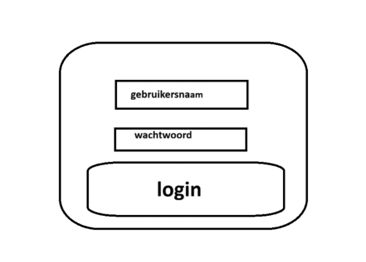
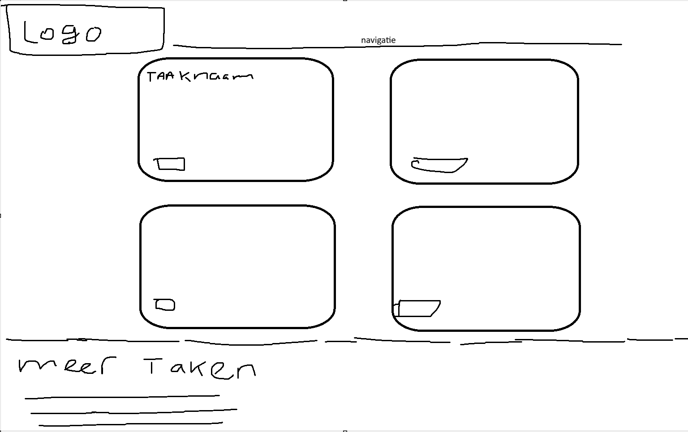
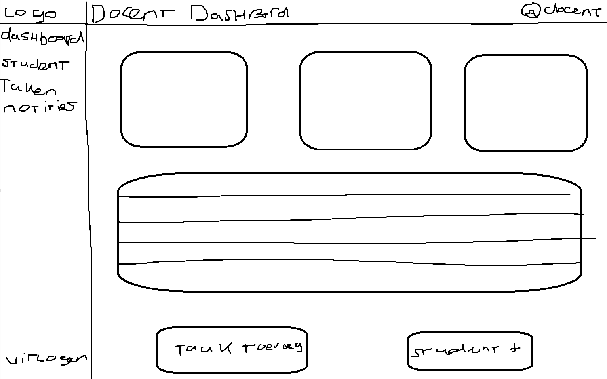
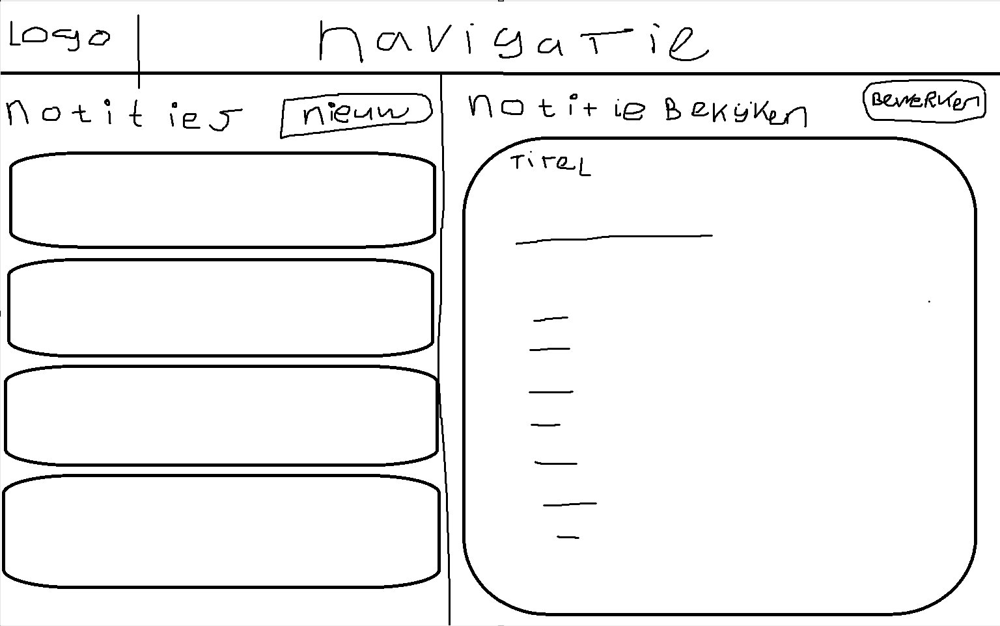
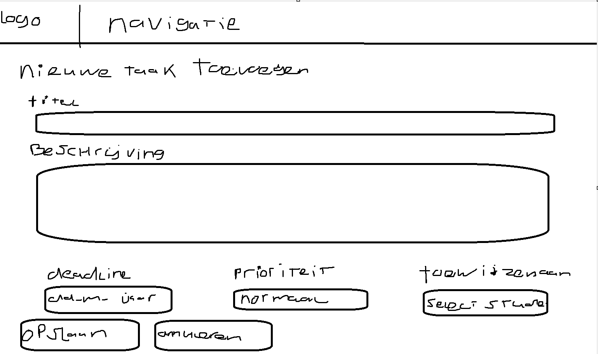
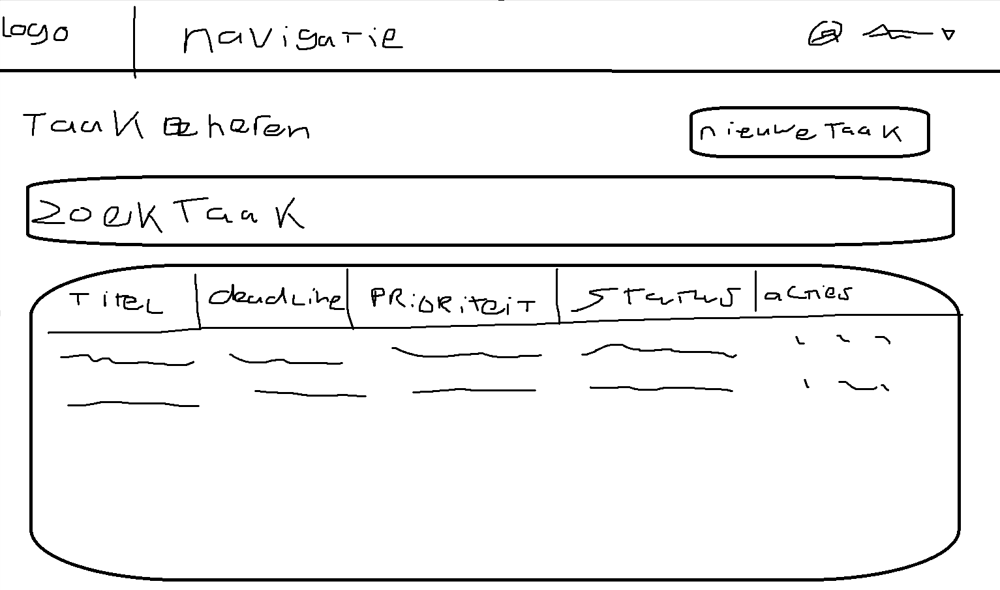

# wireframe(s)

## loginscherm

Op dit scherm kan de gebruiker inloggen met een gebruikersnaam en wachtwoord om toegang te krijgen tot de applicatie.

## Dashboard Student

Op dit scherm ziet de student een overzicht van zijn taken. De student kan taken bekijken, sorteren en de voortgang volgen.

## Dashboard docent

Op dit scherm heeft de docent toegang tot het beheer van studenten en taken binnen de applicatie.

## Notitiepagina

Op dit scherm kan de student notities aanmaken, bekijken en beheren voor eigen gebruik.

## Taak toevoegen

Op dit scherm kan een docent een nieuwe taak aanmaken door een titel, beschrijving, deadline en prioriteit in te vullen.

## Taken beheren

Op dit scherm kan een docent bestaande taken bekijken, aanpassen en verwijderen.

